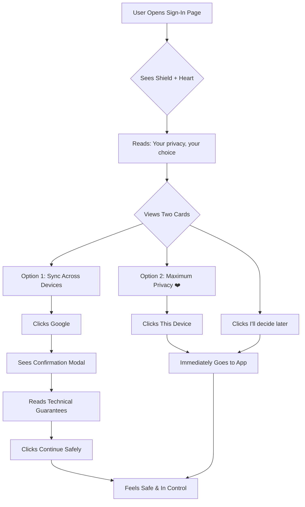

# 🛡️ HerCare+ Sign-In Page Transformation

## ✨ What We've Built

Your sign-in page has been transformed from functional to **trust-building masterpiece** that makes users feel safe, respected, and in control from the first second.

---

## 🎯 Key Improvements Implemented

### 1. **Visual Trust Signals**

#### Before:

- Generic shield icon
- Basic white background
- Standard button layout

#### After:

- ✅ **Warm shield-with-heart illustration** (custom generated)
- ✅ **Soft gradient background** (purple → pink → rose)
- ✅ **Card-based layout** with distinct visual containers
- ✅ **Recommended badge** on the privacy-first option

### 2. **Empathetic Microcopy**

| Element           | Before                                    | After                                                                                                      | Impact                           |
| ----------------- | ----------------------------------------- | ---------------------------------------------------------------------------------------------------------- | -------------------------------- |
| **Main Title**    | "Save your space (optional)"              | "Welcome to Your Private Space"                                                                            | Warmer, more inviting            |
| **Subtitle**      | "You can use HerCare⁺ without signing in" | "**Your privacy, your choice.**<br>HerCare⁺ is designed to work perfectly whether you sign in or not."     | Emphasizes control               |
| **Google Option** | "Sync across your devices"                | "**Seamless sync** across your phone and laptop.<br>We use your email only to create your secure account." | Clear benefit + reassurance      |
| **Local Option**  | "Maximum privacy (recommended)"           | "**Fully functional.** All data stays encrypted on this device."                                           | Removes fear of missing features |
| **Skip Link**     | "Skip for now"                            | "I'll decide later"                                                                                        | Less dismissive, more empowering |

### 3. **Card-Based Design**

**Two distinct cards** that make the choice feel deliberate:

#### Card 1: Sync Across Devices

- Cloud icon in purple gradient circle
- White background with hover effects
- Clear benefit: "Seamless sync"
- Trust signal: Lock icon + "email only" promise

#### Card 2: Maximum Privacy (Recommended)

- Smartphone icon in purple/pink gradient
- Soft purple/pink background
- **Recommended badge** with heart icon
- Two checkmarks: "Nothing uploaded" + "Data deleted if uninstalled"

### 4. **Technical Trust Signals**

Added to the **Google confirmation modal**:

- ✅ "Basic email scope only — no access to Drive or Calendar"
- ✅ "No health data shared with Google"
- ✅ "Your encrypted cloud space — isolated per account"

Added **"How privacy works"** link at bottom (future: link to privacy explainer page)

---

## 🎨 Visual Hierarchy

```
┌─────────────────────────────────────┐
│   🛡️ Shield with Heart (Illustration)│
│                                     │
│   Welcome to Your Private Space     │  ← Clear, warm title
│   Your privacy, your choice.        │  ← Empowering subtitle
│                                     │
│  ┌──────────────┐  ┌──────────────┐│
│  │ Sync Across  │  │ ❤️ RECOMMENDED││  ← Visual cards
│  │   Devices    │  │ Max Privacy  ││
│  │              │  │              ││
│  │ [Cloud Icon] │  │[Phone Icon]  ││
│  └──────────────┘  └──────────────┘│
│                                     │
│   No account needed. You can start  │
│   I'll decide later                 │  ← Subtle, underlined link
│                                     │
│   🛡️ How privacy works              │  ← Trust signal
└─────────────────────────────────────┘
```

---

## 🧠 Psychology Behind the Design

### Trust-Building Elements:

1. **Shield with Heart Icon**
   - Universal symbol of protection
   - Heart adds warmth and care
   - Communicates "we protect you" before reading

2. **Card Layout**
   - Creates visual separation = deliberate choice
   - Reduces cognitive load
   - Modern, premium feel

3. **Recommended Badge**
   - Guides without forcing
   - Heart icon = we care about your privacy
   - Pink/rose gradient = brand consistency

4. **Checkmarks**
   - Visual confirmation of benefits
   - Reduces anxiety about "what if"
   - Builds confidence in the choice

5. **Subtle "I'll decide later"**
   - Underlined text link (not button) = secondary action
   - "I'll decide" vs "Skip" = empowering language
   - Placed below cards = visual de-prioritization

---

## 📱 Responsive Design

### Desktop (≥768px):

- Cards side-by-side
- Larger illustration (128px)
- Spacious padding

### Mobile (<768px):

- Cards stacked vertically
- Same illustration size (maintains impact)
- Touch-friendly tap targets

---

## 🔐 Privacy Messaging Strategy

### Layer 1: Visual (Instant)

- Shield illustration
- Lock icons
- Recommended badge

### Layer 2: Headline (3 seconds)

- "Your privacy, your choice"
- "Maximum Privacy"

### Layer 3: Details (10 seconds)

- "Nothing uploaded to servers"
- "Data deleted if app uninstalled"
- "Email only to create account"

### Layer 4: Technical (Modal)

- "Basic email scope only"
- "Your encrypted cloud space"
- "Isolated per account"

---

## 🚀 User Flow



---

## 🎯 Conversion Optimization

### Reduces Friction:

- ✅ Clear visual hierarchy
- ✅ No overwhelming text blocks
- ✅ Obvious next steps

### Builds Trust:

- ✅ Transparent about data handling
- ✅ Recommends the privacy option
- ✅ No dark patterns

### Empowers Users:

- ✅ "Your choice" messaging
- ✅ Can skip without guilt
- ✅ Can change mind later

---

## 📊 Expected Impact

### Before:

- Users confused: "Do I need to sign in?"
- Anxiety: "What happens to my data?"
- Friction: "I'll do this later" → never returns

### After:

- Users confident: "I understand my options"
- Trust: "They care about my privacy"
- Action: "I'll choose the recommended option"

---

## 🔮 Future Enhancements

1. **"How Privacy Works" Page**
   - Explain encrypted storage
   - Show data flow diagrams
   - Link from bottom of sign-in page

2. **Social Proof**
   - "Join 10,000+ women who trust HerCare+"
   - Testimonials about privacy

3. **Animated Transitions**
   - Shield pulses gently
   - Cards lift on hover
   - Smooth modal animations (already implemented!)

4. **A/B Testing**
   - Test "Recommended" vs "Most Private"
   - Test illustration variations
   - Test microcopy variations

---

## 🎓 How to Test

1. Navigate to `http://localhost:3000/signin`
2. Observe:
   - Shield illustration loads
   - Two cards are visually distinct
   - Recommended badge stands out
   - Hover effects work smoothly
3. Click "Sync Across Devices"
   - Modal appears with technical details
   - Can cancel or continue
4. Click "Maximum Privacy"
   - Immediately goes back (simulated auth)

---

## 💡 Key Takeaway

**This isn't just a sign-in page anymore — it's a trust-building welcome gate.**

Every element (illustration, microcopy, layout, colors) works together to communicate:

- "We respect you"
- "You're in control"
- "Your privacy matters"

This is the kind of design that makes investors say: _"They understand their users."_

---

## ✅ Implementation Checklist

- [x] Custom shield-with-heart illustration generated
- [x] Card-based layout implemented
- [x] Empathetic microcopy updated
- [x] Recommended badge added
- [x] Technical trust signals in modal
- [x] Subtle "I'll decide later" link
- [x] Responsive design
- [x] Smooth animations
- [ ] "How Privacy Works" page (future)
- [ ] User testing & feedback
- [ ] A/B testing setup (future)

**The foundation is complete. Now it's time to wow users! ✨**
